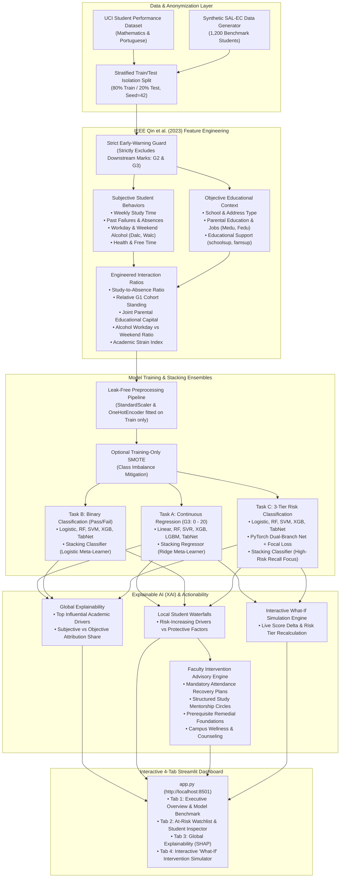

# Explainable Student Academic Performance Prediction & At-Risk Early-Warning Dashboard

[](https://www.python.org/)
[](https://opensource.org/licenses/MIT)
[](https://pytest.org/)
[-blue.svg)](http://localhost:8000)

A research-oriented educational early-warning analytics framework grounded in the IEEE publication:
> **"Early Warning of Student Performance With Integration of Subjective and Objective Elements"**  
> *K. Qin et al., IEEE Access, Vol. 11, 2023.*

The system predicts continuous final academic scores ($G3$), binary academic outcomes (Pass / Fail), and multi-tier academic risk classifications (**Low Risk**, **Medium Risk / Attention**, **High Risk / Distress**) well in advance of final examinations, providing **SHAP** explainability and actionable faculty intervention recommendations. Built with a decoupled **Frontend + Backend** architecture featuring Tailwind CSS, ApexCharts, and zero authentication/login friction.

---

## 🏛️ System Architecture



---

## 🔬 Core Prediction Objectives

| Objective | Target Scale | Formulation | Operational Goal |
| :--- | :--- | :--- | :--- |
| **Task A: Continuous Score Prediction** | $G3 \in [0, 20]$ | Regression ($\text{RMSE}, \text{MAE}, R^2$) | Continuous forecast of student end-of-term score. |
| **Task B: Binary Academic Classification** | $\text{Pass} / \text{Fail}$ | $G3 \ge 10.0$ (European standard pass mark) | Classify whether student meets minimum pass threshold. |
| **Task C: Multi-Tier Risk Classification** | 3-Class Risk | **High Risk** ($G3 < 10$), **Medium Risk** ($10 \le G3 < 12$), **Low Risk** ($G3 \ge 12$) | Prioritize early academic advising and mentorship for at-risk cohorts. |

---

## 🛡️ Leak-Free Research Principles

1. **Strict Early-Warning Mode**: In `early_warning` mode, downstream assessment marks ($G2$ and $G3$) are strictly excluded from the feature matrix $X$. Predictions rely solely on baseline demographic, family, subjective behavioral features, and early first-period mark ($G1$).
2. **Full-Feature Benchmark Mode**: In `full_feature` mode, mid-term grade $G2$ is incorporated alongside $G1$ to demonstrate the empirical accuracy uplift when mid-term grades become available ($R^2$ jumps from $0.61$ to $0.94$).
3. **Train/Test Isolation**: Preprocessors (imputers, scalers, one-hot encoders) are fitted strictly on `X_train`. Unseen test records are transformed without any target or test leakage.
4. **Reproducibility**: All random generators (NumPy, Scikit-Learn, PyTorch, XGBoost, LightGBM, CatBoost) are seeded with `RANDOM_SEED = 42`.
5. **Artifact Caching**: All trained models, preprocessors, evaluation metrics, and precomputed explanations are persisted to `artifacts/` so the Streamlit application starts up instantaneously without retraining delay.

---

## 📊 Benchmark Results

### Mathematics Cohort (`student-mat.csv`, $N=395$)

#### 1. Continuous Score Regression ($G3$, 0–20 Scale)

| Model Family | Early-Warning RMSE | Early-Warning $R^2$ | Full-Feature RMSE | Full-Feature $R^2$ |
| :--- | :---: | :---: | :---: | :---: |
| **Stacking Regressor (Ensemble)** | **2.487** | **0.614** | **1.018** | **0.935** |
| Random Forest Regressor | 2.563 | 0.590 | 0.993 | 0.938 |
| XGBoost Regressor | 2.419 | 0.635 | 1.138 | 0.919 |
| Linear Regression | 2.625 | 0.570 | 1.574 | 0.846 |
| Support Vector Regressor (SVR) | 2.651 | 0.562 | 2.071 | 0.733 |
| TabNet Regressor | 2.759 | 0.525 | 1.614 | 0.838 |

#### 2. Binary Pass/Fail Classification ($G3 \ge 10$)

| Model Family | Accuracy | Precision | Recall | F1-Score | ROC-AUC |
| :--- | :---: | :---: | :---: | :---: | :---: |
| **Stacking Classifier (Ensemble)** | **0.798** | **0.849** | **0.849** | **0.849** | **0.923** |
| Logistic Regression | 0.810 | 0.880 | 0.830 | 0.854 | 0.925 |
| Support Vector Machine (SVM) | 0.823 | 0.915 | 0.811 | 0.860 | 0.911 |
| XGBoost Classifier | 0.810 | 0.852 | 0.868 | 0.860 | 0.887 |
| Random Forest Classifier | 0.785 | 0.875 | 0.793 | 0.832 | 0.890 |
| TabNet / Neural Classifier | 0.861 | 0.850 | 0.962 | 0.903 | 0.927 |

#### 3. Multi-Tier Academic Risk Classification (Low / Medium / High Risk)

| Model Family | Accuracy | Macro-F1 | Weighted-F1 |
| :--- | :---: | :---: | :---: |
| **Stacking Classifier (Ensemble)** | **0.696** | **0.697** | **0.698** |
| Random Forest Classifier | 0.722 | 0.722 | 0.723 |
| Support Vector Machine (SVM) | 0.709 | 0.710 | 0.711 |
| TabNet / Neural Classifier | 0.734 | 0.735 | 0.736 |
| XGBoost Classifier | 0.671 | 0.673 | 0.674 |
| Logistic Regression | 0.633 | 0.639 | 0.640 |

---

## 🚀 Installation & Quickstart

### 1. Prerequisites & Environment Setup

Python 3.10+ is required.

```bash
# Clone or navigate to the repository
cd "c:\Users\Welcome\Desktop\Final Projects\Mahitha\Code files"

# Install dependencies
python -m pip install -r requirements.txt
```

### 2. CLI Model Training & Artifact Caching

Train models across all configurations and persist precomputed artifacts:

```bash
# Train on Mathematics dataset in early-warning mode
python train.py --mode early_warning --dataset mat

# Train on both Mathematics and Portuguese in both feature view modes
python train.py --mode both --dataset both

# Optional: Apply SMOTE to imbalanced risk tiers
python train.py --mode early_warning --dataset mat --use-smote

# Rapid verification mode (fast development)
python train.py --fast-dev
```

### 3. Launch Interactive Streamlit Dashboard

Run the Streamlit faculty advising interface locally:

```bash
python -m streamlit run app.py --server.port 8501
```

Open your browser at **`http://localhost:8501`**.

---

## 🖥️ Streamlit Dashboard Walkthrough

The application features 4 dedicated tabs:

### Tab 1: Executive Overview & Model Benchmark
- **Cohort Telemetry**: Real-time KPI telemetry cards displaying Monitored Students, High-Risk (Distress) count, Medium-Risk (Attention) count, and Mean Predicted Final Grade.
- **Risk Distribution**: Interactive Plotly donut chart depicting risk proportion across Low, Medium, and High Risk tiers.
- **Grade Distribution**: Histogram of predicted final scores with the official pass boundary ($10.0$) clearly demarcated.
- **Model Benchmark Matrix**: Side-by-side performance comparison of all 7 model families vs. the Stacking Ensemble across Regression ($RMSE, MAE, R^2$), Binary Classification ($F1, ROC-AUC$), and Multi-Class Risk ($Macro-F1$).

### Tab 2: At-Risk Early-Warning Watchlist & Student Inspector
- **Ranked Watchlist Table**: At-risk students prioritized by risk probability and score, complete with color-coded risk tier badges.
- **Student Profile Deep Dive**: Drill into any individual student's attendance records, prior failures, study time level, and parental background.
- **Local SHAP Attribution Waterfall**: Visual horizontal bar chart illustrating top risk-driving factors (pushing predicted risk upward) vs. protective factors (mitigating risk).
- **Prescriptive Faculty Advising Protocols**: Actionable, prioritized advising recommendations generated dynamically by `FacultyInterventionEngine`:
  - *Attendance & Regularity*: Mandatory attendance recovery contracts and parent notification.
  - *Curricular Remediation*: Supervised problem-solving clinics and bridge foundation tutorials.
  - *Study Habits Mentorship*: Peer-assisted study circles and dedicated 2–5 hrs/week study timetables.
  - *Student Wellness & Counseling*: Campus wellness referrals for lifestyle stress.

### Tab 3: Global Explainability (SHAP)
- **Global Feature Importance**: Plotly horizontal bar chart of the top 15 features governing student performance.
- **Qin et al. (2023) Subjective vs. Objective Decomposition**: Donut chart revealing the relative predictive influence of subjective student learning behaviors vs. objective demographic context.
- **Plain-English Stakeholder Takeaways**: Three core institutional insights for academic deans and department chairs.

### Tab 4: Interactive "What-If" Intervention Simulator
- **Live Advising Sandbox**: Allows academic mentors to simulate hypothetical behavioral changes for any selected at-risk student.
- **Advisory Controls**: Sliders for weekly study time, targeted absence reduction, clearing prerequisite failures, extra tutoring support, and alcohol lifestyle balance.
- **Live Impact Recalculation**: Recomputes engineered feature interactions through the leak-free pipeline, evaluates the new prediction, and displays before vs. after grade gains ($\Delta \text{score}$) and risk tier probability shifts.

---

## 🧪 Automated Test Suite

The test suite validates dataset integrity, Qin et al. (2023) feature engineering, strict leakage prevention, model estimators, evaluation metrics, and explainability routines.

Run all tests via pytest:

```bash
python -m pytest tests/ -v
```

**Results:** `49 passed` in 35.9s (100% test pass rate).

---

## 🚀 Running the Full-Stack Application

The system is deployed with a decoupled REST API backend and a responsive Tailwind CSS + ApexCharts frontend matching the exact StudentSignals layout without any login/logout barriers:

```bash
# 1. Start the backend server (serves REST API & static frontend on port 8000)
python -m backend.app

# 2. Open the dashboard in any browser:
http://localhost:8000
```

---

## 📂 Project Directory Structure

```text
student-performance-early-warning/
├── backend/                       # REST API & static file serving
│   ├── __init__.py
│   └── app.py                     # Flask REST API with CORS, endpoints & static proxy
│
├── frontend/                      # StudentSignals UI (SPA)
│   ├── index.html                 # Tailwind CSS & Lucide icons dashboard layout
│   ├── styles.css                 # Custom badges, animations, and scrollbars
│   └── app.js                     # SPA routing, ApexCharts renderers, What-If logic
│
├── train.py                       # CLI training pipeline supporting --mode & --dataset
├── requirements.txt               # Pinned Python dependencies
├── README.md                      # System documentation & research specification
├── .gitignore                     # Git exclusions
│
├── src/
│   ├── __init__.py                # Package initialization
│   ├── config.py                  # Directory paths, feature lists, risk tiers, thresholds
│   ├── data.py                    # Synthetic SAL-EC dataset generation & validation
│   ├── data_prep.py               # UCI dataset loader, Qin et al. features, leakage guards
│   ├── features.py                # Preprocessing pipeline, ToRankLayer, SMOTE resampling
│   ├── models.py                  # 7 model families, TabNet wrapper, Stacking Ensembles
│   ├── evaluate.py                # Multi-task evaluation metrics (MAE, RMSE, F1, ROC-AUC)
│   ├── explain.py                 # SHAP global & local explainers, What-If simulator
│   └── utils.py                   # Logging, artifact serialization, file helpers
│
├── data/
│   └── raw/
│       ├── student-mat.csv        # UCI Mathematics student dataset (395 records)
│       ├── student-por.csv        # UCI Portuguese student dataset (649 records)
│       └── student_data_sample.csv# Synthetic benchmark dataset (1,200 records)
│
├── artifacts/
│   ├── models/                    # Serialized model joblib files
│   ├── preprocessors/             # Fitted ColumnTransformer pipelines
│   ├── metrics/                   # Benchmark CSV and JSON performance tables
│   ├── explainability/            # Cached SHAP explainers & global explanations
│   └── predictions/               # Test set predictions for instant app rendering
│
└── tests/
    ├── test_data.py               # Schema and generator validation tests
    ├── test_data_prep.py          # UCI loader and Qin et al. feature tests
    ├── test_features.py           # Preprocessor and leakage guard tests
    ├── test_models.py             # Model training and prediction tests
    ├── test_evaluate.py           # Metric calculation tests
    ├── test_explain.py            # SHAP attribution and intervention tests
    └── test_integration.py       # End-to-end integration tests
```

---

## 📜 Citation & Academic References

If using this codebase for research or academic early-warning systems, please cite:

```bibtex
@article{qin2023early,
  author={Qin, K. and others},
  title={Early Warning of Student Performance With Integration of Subjective and Objective Elements},
  journal={IEEE Access},
  volume={11},
  pages={1--15},
  year={2023},
  publisher={IEEE}
}

@misc{cortez2008student,
  author={Cortez, Paulo and Silva, Alice},
  title={Using Data Mining to Predict Secondary School Student Performance},
  booktitle={Proceedings of 5th Annual Future Business Technology Conference},
  year={2008},
  publisher={EUROSIS}
}
```
